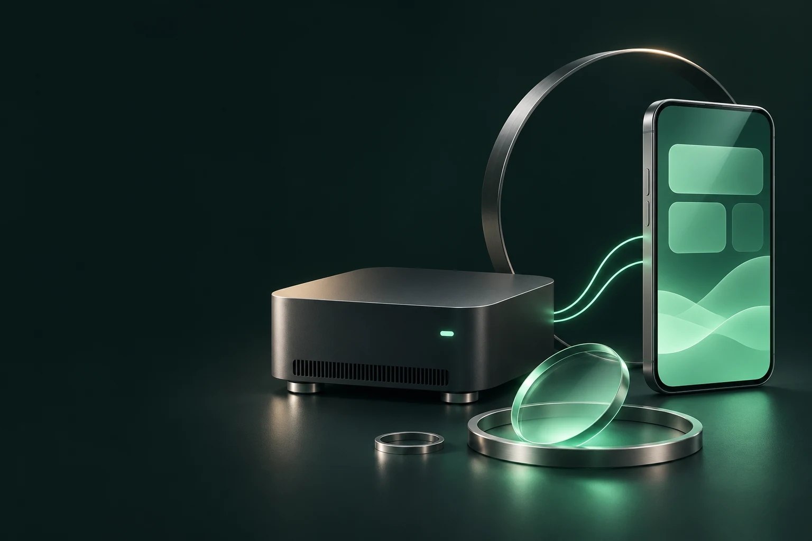

# TandemForge

**Try local AI on your own Windows PC, then use it from your own phone.** TandemForge is a free, bilingual workspace for people new to local AI. Start with a small model, see what your PC can handle, and learn by changing one setting at a time. Your PC does the work while your browser gives you the same workspace on desktop and phone.

[อ่านภาษาไทย](README.th.md) · [Release notes](CHANGELOG.md) · [Upstream projects and terms](THIRD_PARTY_NOTICES.md)

**Unreleased preview.** See [measured checks and remaining release gates](VERIFICATION.md). Fresh Windows setup, 8 GB hardware and real-phone browser use are not yet verified.

## Start in three steps

1. Extract the Windows preview ZIP provided by the maintainer (GitHub Releases after publication). Double-click **Setup TandemForge.cmd**. If Python is missing, accept the Python prompt. Windows App Installer provides `winget` for Python and optional Tailscale.
2. In Setup, keep the recommended chat model for your PC or choose another. **Vulkan** uses a supported GPU. **CPU** runs on the processor. Add matching image projectors to let the chat model read an attachment. Select ComfyUI and its Image Lab model pack if you want to generate and edit images.
3. Choose **Open TandemForge** or run **Run TandemForge.cmd**. Enter the access code printed in the console, then open **Dialogue**. Try “Explain what a local AI model is in two sentences.” The browser remembers the session for 30 days.

Setup downloads selected files from their upstream sources, verifies SHA-256, and can resume incomplete downloads. Reopen Setup to add components or use an existing installation. App data defaults to `%LOCALAPPDATA%\TandemForge`. You can choose the chat model folder separately.

## What PC do I need?

These are starting estimates for Windows 11 x64. Available RAM, drivers, and other workloads affect results. The first load can take longer.

| Start here | System RAM | Dedicated VRAM | Free disk to allow | Suggested first job |
| --- | ---: | ---: | ---: | --- |
| Basic chat on CPU | 8 GB with about 3 GiB free | Optional | 4 GiB | Qwen 3.5 2B Q4 with a 2,048-token context |
| Faster chat on GPU | 16 GB | 6 GB | 6 GiB | Qwen 3.5 4B Q4 with a 3,072-token context |
| Larger chat model | 16–24 GB | 10–16 GB | 10 GiB | Qwen 3.5 9B or Gemma 4 12B at 4,096 context |
| Image Lab | 16 GB to start, 32 GB recommended | 8 GB starting estimate | 25 GiB | FLUX.2 Klein 4B FP8 at 512 × 512 |

Use **Overview → Find a model for this PC** to see RAM, dedicated VRAM and free storage. If it suggests CPU mode, select the CPU runtime in Setup or set **GPU layers** to `0`. Image Lab uses a separate ComfyUI runtime and model pack. Start with Dialogue if your PC is near the basic chat tier.

The Qwen 2B CPU setup was verified with GPU offload disabled and a 2,048-token context on a 32 GB-class PC. The 8 GB row is an estimate for a low-memory system.

The compact 2B model is for trying short chats. It made an arithmetic error in one English probe, so use a larger model for reasoning and check important answers. The Setup-managed AMD Image Lab passed a 512 × 512 draft and an edit on the measured 16 GB-class GPU. Edits currently render 768 × 1024. [Measured results](VERIFICATION.md)

## Open it on your phone

1. Select **Tailscale for phone access** in Setup, or install the official Windows client. Install Tailscale on your phone and sign both devices into the same tailnet. [Tailscale Windows instructions](https://tailscale.com/docs/install/windows)
2. Keep the Windows PC awake with TandemForge running. On the PC, open **Run Phone Access.cmd**. Follow the Tailscale HTTPS prompt if it appears.
3. Open the private HTTPS address printed by the script on your phone. Enter the app code, then use **Add to Home Screen** if you want an app icon. [How Tailscale Serve shares within your tailnet](https://tailscale.com/docs/features/tailscale-serve)

## Learn by changing one thing

- In **Dialogue**, use **Quick chat**, **Detailed instructions**, **Reasoning**, **Read an image**, or **JSON output** as available. Each mode chooses a matching model and applies settings to messages from that page. **Custom** uses your saved settings.
- In **Preferences**, try a smaller context to save memory or a lower temperature for more consistent replies. Reuse the same prompt and compare the answers. Pick **EN** or **ไทย** in the header.
- In **Actions**, ask for a plan to check the queue or work with a file in the app workspace. Review the plan before running it. Manage allowed actions in **Preferences**.
- In **Image Lab**, start with a **512 × 512 draft**. Try a larger size once the draft runs on your hardware.

Already use local AI? Choose **Use existing** in Setup to point at your llama-server, model folder, or loopback ComfyUI URL. This preview covers chat, image attachments, image generation and editing, and built-in Actions. Video and audio workflows are outside this preview.

TandemForge is free to use. Optional sponsorship is the funding plan. [Release preparation](RELEASE.md)
