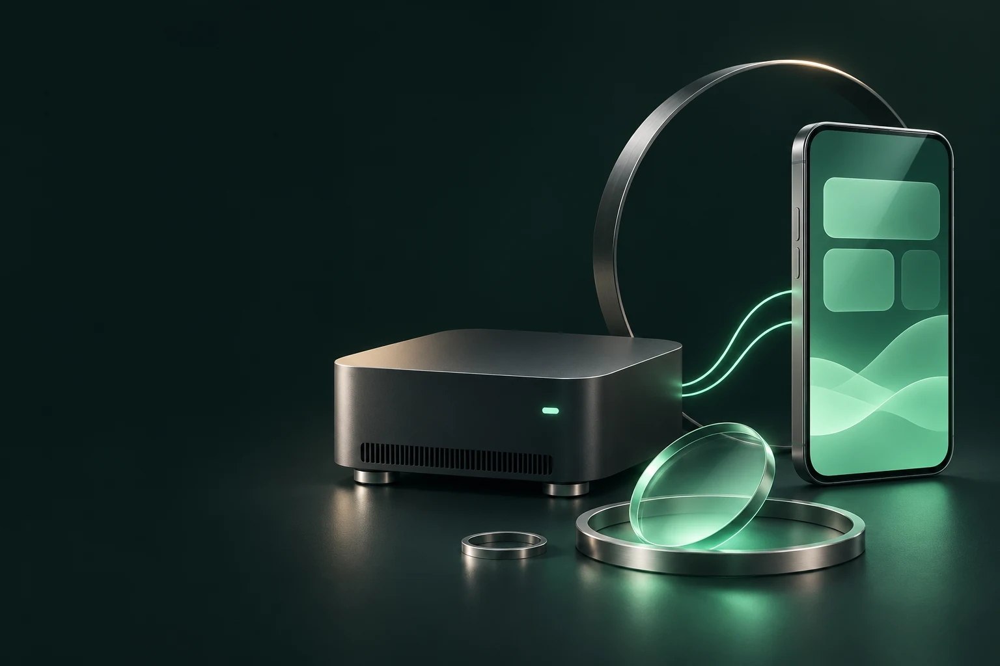

# TandemForge

**ลองรัน AI บนคอม Windows ของตัวเอง แล้วใช้งานจากมือถือของตัวเองได้** TandemForge เป็นแอปฟรีสองภาษาสำหรับคนที่เพิ่งเริ่มรู้จัก Local AI เริ่มจากโมเดลเล็ก ดูว่าเครื่องรับไหวแค่ไหน แล้วค่อยเรียนรู้จากการปรับทีละค่า คอมเป็นเครื่องประมวลผล ส่วนมือถือเปิดพื้นที่ทำงานเดียวกันผ่านเบราว์เซอร์

[English](README.md) · [บันทึกรุ่น](CHANGELOG.md) · [โครงการต้นทางและเงื่อนไข](THIRD_PARTY_NOTICES.md)

**พรีวิวยังไม่เผยแพร่** อ่าน [ผลทดสอบและเงื่อนไขที่ยังต้องตรวจ](VERIFICATION.md) ยังไม่ยืนยัน Windows ใหม่ที่ไม่มี Python เครื่อง RAM 8 GB และการใช้งานผ่านเบราว์เซอร์มือถือจริง

## เริ่มใช้ในสามขั้น

1. แตก ZIP รุ่นพรีวิวที่เจ้าของโครงการส่งให้ (หลังเผยแพร่จะดาวน์โหลดจาก GitHub Releases ได้) ดับเบิลคลิก **Setup TandemForge.cmd** ถ้าเครื่องยังไม่มี Python ให้ตอบรับการติดตั้ง Windows App Installer มี `winget` สำหรับลง Python และ Tailscale
2. เลือกโมเดลแชทที่ Setup แนะนำ หรือลองรุ่นอื่นที่เหมาะกับเครื่อง **Vulkan** ใช้การ์ดจอที่รองรับ ส่วน **CPU** ใช้หน่วยประมวลผลของเครื่อง เพิ่มตัวอ่านภาพถ้าอยากให้แชทดูรูป เลือก ComfyUI และชุดโมเดลห้องสร้างภาพถ้าอยากสร้างหรือแก้ไขภาพ
3. กด **Open TandemForge** หรือเปิด **Run TandemForge.cmd** ใส่รหัสที่แสดงในหน้าต่างคอนโซล แล้วเข้า **ห้องสนทนา** ลองพิมพ์ “อธิบายว่า Local AI คืออะไรในสองประโยค” เบราว์เซอร์จำการเข้าสู่ระบบไว้ 30 วัน

Setup ดาวน์โหลดรายการที่เลือกจากต้นทาง ตรวจ SHA-256 และโหลดต่อได้เมื่อดาวน์โหลดขาดช่วง เปิด Setup อีกครั้งได้เมื่อต้องการเพิ่มส่วนประกอบหรือเชื่อมของที่มีอยู่แล้ว ข้อมูลแอปเก็บที่ `%LOCALAPPDATA%\TandemForge` เป็นค่าเริ่มต้น และเลือกโฟลเดอร์โมเดลแชทแยกได้

## ใช้คอมสเปกเท่าไร

ตารางนี้เป็นสเปกเริ่มต้นสำหรับ Windows 11 x64 ความเร็วจริงขึ้นกับ RAM ที่ว่าง ไดรเวอร์ และงานอื่นที่เปิดอยู่ ครั้งแรกที่โหลดโมเดลอาจใช้เวลานานขึ้น

| งานที่อยากเริ่ม | RAM เครื่อง | VRAM แยก | พื้นที่ที่ควรเผื่อ | ลองแบบนี้ก่อน |
| --- | ---: | ---: | ---: | --- |
| แชทเบาด้วย CPU | 8 GB และว่างประมาณ 3 GiB | ใช้ CPU ได้ | 4 GiB | Qwen 3.5 2B Q4, Context 2,048 |
| แชทเร็วขึ้นด้วย GPU | 16 GB | 6 GB | 6 GiB | Qwen 3.5 4B Q4, Context 3,072 |
| แชทด้วยโมเดลใหญ่ขึ้น | 16–24 GB | 10–16 GB | 10 GiB | Qwen 3.5 9B หรือ Gemma 4 12B, Context 4,096 |
| สร้างและแก้ไขภาพ | เริ่มที่ 16 GB แนะนำ 32 GB | ประเมินเริ่มที่ 8 GB | 25 GiB | FLUX.2 Klein 4B FP8 ที่ 512 × 512 |

ไปที่ **ภาพรวม → ตรวจสเปก** เพื่อดู RAM, VRAM แยก และพื้นที่เก็บโมเดล ถ้าแอปแนะนำ CPU ให้เลือกเอนจิน CPU ตอนติดตั้งหรือตั้ง **GPU layers** เป็น `0` งานภาพใช้ ComfyUI และชุดโมเดลภาพแยกจากแชท เครื่องใกล้สเปกขั้นต่ำเริ่มจากแชทก่อนแล้วค่อยเพิ่มงานอื่นได้

ทดสอบ Qwen 2B แบบ CPU ที่ Context 2,048 และปิดการส่งงานไป GPU บนเครื่อง RAM ระดับ 32 GB แล้ว ส่วนแถว RAM 8 GB เป็นค่าประเมินสำหรับเครื่องหน่วยความจำน้อย

โมเดล 2B เหมาะกับลองแชทสั้น ๆ พบคำตอบคำนวณผิดในโจทย์อังกฤษหนึ่งครั้ง งานคิดวิเคราะห์ควรเลือกโมเดลใหญ่ขึ้นและตรวจคำตอบสำคัญ ชุด Image Lab ที่ Setup จัดการผ่านทั้ง Draft 512 × 512 และแก้ภาพบน AMD VRAM ระดับ 16 GB ในรอบนี้ งานแก้ภาพปัจจุบันส่งออก 768 × 1024 [ผลที่วัดได้](VERIFICATION.md)

## เปิดใช้จากมือถือ

1. เลือก **Tailscale for phone access** ใน Setup หรือลง Tailscale สำหรับ Windows จากต้นทาง ติดตั้งบนมือถือด้วย แล้วลงชื่อเข้าใช้ทั้งสองเครื่องใน tailnet เดียวกัน [คู่มือติดตั้ง Tailscale บน Windows](https://tailscale.com/docs/install/windows)
2. เปิด TandemForge ค้างไว้บนคอมและให้คอมตื่นอยู่ จากนั้นเปิด **Run Phone Access.cmd** ทำตามข้อความของ Tailscale หากมีหน้าขอเปิด HTTPS
3. เปิดที่อยู่ HTTPS ส่วนตัวที่สคริปต์แสดงบนมือถือ ใส่รหัสแอป แล้วเลือก **เพิ่มลงหน้าจอโฮม** ในเบราว์เซอร์ได้ [วิธีแชร์ภายใน tailnet ด้วย Tailscale Serve](https://tailscale.com/docs/features/tailscale-serve)

## ลองเรียนรู้และปรับเอง

- หน้า **ห้องสนทนา** เลือก **คุยเร็ว**, **งานหลายเงื่อนไข**, **คิดวิเคราะห์**, **อ่านภาพ** หรือ **ส่งออก JSON** ตามโมเดลที่ติดตั้ง โหมดจะเลือกโมเดลและใช้ค่ากับข้อความที่ส่งจากหน้านั้น **กำหนดเอง** ใช้ค่าที่บันทึกไว้
- หน้า **ตั้งค่า** ลองลด Context เพื่อประหยัดหน่วยความจำ หรือลด Temperature เพื่อให้รูปแบบคำตอบสม่ำเสมอขึ้น ใช้พรอมป์เดิมเปรียบเทียบก่อนและหลัง แล้วสลับเมนู **EN / ไทย** ได้จากหัวแอป
- หน้า **งานอัตโนมัติ** ให้ Agent เสนอแผนตรวจคิวหรือจัดการไฟล์ในพื้นที่ของแอป อ่านแผนก่อนอนุมัติ และกำหนดสิทธิ์ได้จากหน้าตั้งค่า
- หน้า **ห้องสร้างภาพ** เริ่มจาก **ลองก่อน 512 × 512** พอรันได้แล้วค่อยขยายขนาด

ถ้ามี Local AI อยู่แล้ว ให้เลือก **Use existing** ใน Setup แล้วชี้ไปที่ llama-server โฟลเดอร์โมเดล หรือที่อยู่ ComfyUI บนเครื่อง รุ่นพรีวิวนี้มีแชท อ่านภาพแนบ สร้างและแก้ไขภาพ และงานอัตโนมัติในแอป ส่วนเวิร์กโฟลว์วิดีโอและเสียงอยู่นอกขอบเขตรุ่นนี้

TandemForge แจกฟรี โดยเปิดรับการสนับสนุนแบบสมัครใจเมื่อช่องทางพร้อม [การเตรียมรุ่นแจก](RELEASE.md)
